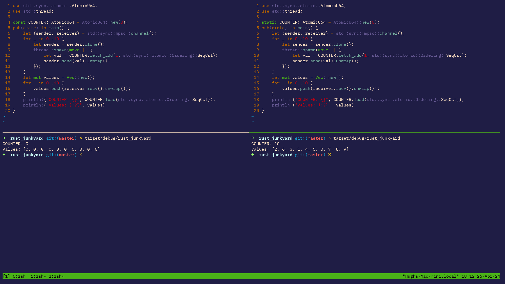

# Counting function invocations



Earlier today I was debugging some code - I wanted to see how many times a function was being called.
In my haste, I wrote the equivalent of this code.

```rust
use std::sync::atomic::AtomicU64;
use std::thread;

const COUNTER: AtomicU64 = AtomicU64::new(0);
pub(crate) fn main() {
    let (sender, receiver) = std::sync::mpsc::channel();
    for _ in 0..10 {
        let sender = sender.clone();
        thread::spawn(move || {
            let val = COUNTER.fetch_add(1, std::sync::atomic::Ordering::SeqCst);
            sender.send(val).unwrap();
        });
    }
    let mut values = Vec::new();
    for _ in 0..10 {
        values.push(receiver.recv().unwrap());
    }
    println!("COUNTER: {}", COUNTER.load(std::sync::atomic::Ordering::SeqCst));
    println!("Values: {:?}", values)
}
```

The above snippet creates 10 threads, and in each thread the atomic counter is read and added to.
The result of the counter is sent to a channel.
Outside the thread-spawning loop we collect all the values from the channel (assuming everything will pass flawlessly), and we display the received counters that were read.

If we look at the output of this program, we can see the same "bug".

```
COUNTER: 0
Values: [0, 0, 0, 0, 0, 0, 0, 0, 0, 0]
```

The function was not incrementing the counter, but I could see it invoked several times!

An Atomic primitive (such as `AtomicU64`) is a concurrency-safe datastructure, that provides safe access to some underlying data primitive type.
Because the data it represents is simple (numbers), Atomics have a limited number of operations that can be made:
- reading
- writing
- reading and writing
- conditional writing (compare and swap)

These operations guarantee that they are atomic - when they start executing, the end result of the operation would have been isolated.
This isn't strictly true, as the `Ordering` enum specifies how relaxed access can be - if you are reading, perhaps you don't mind if you read a stale or fresh version.
For the purpose of this code, `Ordering::SeqCst` means that all access is sequential consistent odering - the strictest access.
This means all operations can be put in a single order and maintain correctness.
In databases, this is called the "serialisable" property.


# Perhaps Mutex is better?

Perhaps there was something I wasn't understanding about Atomic Counters and thread safety.
I decided to take the sledgehammer route and adopt a `Mutex` instead - I know this should work.

```
use std::sync::{Arc, Mutex};
use std::thread;
use once_cell::unsync::Lazy;

const COUNTER: Lazy<Arc<Mutex<u64>>> = Lazy::new(|| Arc::new(Mutex::new(0)));
pub(crate) fn main() {
    let (sender, receiver) = std::sync::mpsc::channel();
    for _ in 0..10 {
        let sender = sender.clone();
        thread::spawn(move || {
            let binding= COUNTER;
            let mut val = binding.lock().unwrap();
            let current = *val;
            *val += 1;
            sender.send(current).unwrap();
        });
    }
    let mut values = Vec::new();
    for _ in 0..10 {
        values.push(receiver.recv().unwrap());
    }
    println!("COUNTER: {}", COUNTER.lock().unwrap());
    println!("Values: {:?}", values)
}
```

Now this is spooky - this also has the same output!
Furthermore, if we add a log message to `Lazy`, we can see that it gets created several times over.
We are modifying different values!

# The a-ha moment

After reading up on `const`, I was reminded there is a difference between `const` and `static` and that I had in fact completely forgotten that `static` was a keyword in Rust.
The `const` keyword means that memory is evaluated at compile time, but it is not an allocation.
It is a value resolution.
That means everywhere in the code where `const COUNTER` was referenced, the value was actually copied from the compile-time resolution, instead of sharing the same memory.
That explains why Lazy was being evaluated several times!
The const declaration of a Lazy struct would have a memory representation (for a hypothetical example `[0x00, 0x00, 0x00, 0x00]`) that is evaluated at compile time, then everywhere in the code where I would reference `COUNTER` it would **copy** that memory `[0x00, 0x00, 0x00, 0x00]` instead of **referencing** the same allocation.


If you want a single shared memory allocation, you need to use static.

Here is the fixed code for anyone interested.

```rust
use std::sync::atomic::AtomicU64;
use std::thread;

static COUNTER: AtomicU64 = AtomicU64::new(0);
pub(crate) fn main() {
    let (sender, receiver) = std::sync::mpsc::channel();
    for _ in 0..10 {
        let sender = sender.clone();
        thread::spawn(move || {
            let val = COUNTER.fetch_add(1, std::sync::atomic::Ordering::SeqCst);
            sender.send(val).unwrap();
        });
    }
    let mut values = Vec::new();
    for _ in 0..10 {
        values.push(receiver.recv().unwrap());
    }
    println!("COUNTER: {}", COUNTER.load(std::sync::atomic::Ordering::SeqCst));
    println!("Values: {:?}", values)
}
```

